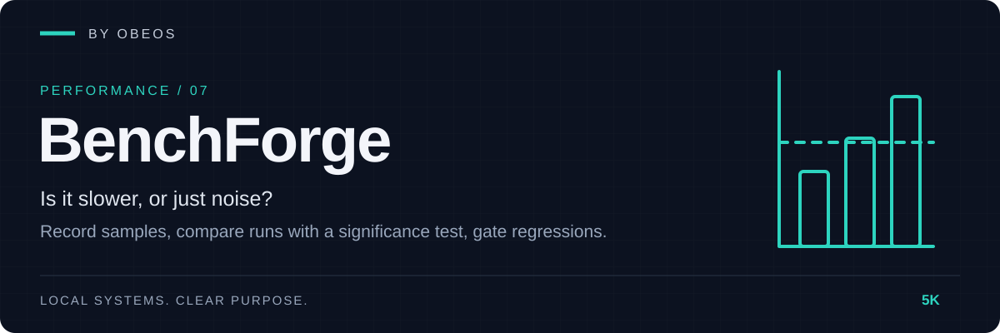

<div align="center">



**Is it slower, or just noise? Record samples, compare two runs with a significance test, and gate regressions in CI.**

[](https://github.com/5K-bit/BenchForge/actions/workflows/ci.yml)


[](LICENSE)

</div>

[Quick start](#quick-start) · [Demonstration](#demonstration) · [Tests](#tests-and-evidence) · [Limitations](#limitations)

---

## Overview

A single timing tells you little: run it twice and you get two numbers. BenchForge **records many samples** of each benchmark (a command, a Python function, or a local model served by Ollama), stores them in a result file along with the machine they came from, and later **compares two result files**: the ratio of medians, a Mann-Whitney test for whether the difference is distinguishable from noise, and a bootstrap interval for the ratio. A change is a **regression** only if it is both bigger than your threshold (default 10%) and statistically significant (default p < 0.01). `compare --fail-on-regression` turns that into an exit code for CI.

Part of the OBEOS projects, and it works completely on its own. No server, no account, no telemetry. The only network use is opt-in: a `model` benchmark talks to your own Ollama, on this machine unless you explicitly allow another host.

**Comparing local models.** A `model` benchmark sends a fixed list of prompts to Ollama (fixed seed, temperature 0) and records one sample per pass, in nanoseconds per generated token, so the same statistics decide whether model B is really slower than model A. It also records tokens per second, time to first token, the memory Ollama reports for the loaded model, and whether the output stayed identical between passes.

> **A suite file is code.** `benchforge run` starts the commands and imports the functions the suite names. Review a suite like a build script. `show` and `compare` only read result files and never run anything.

## Demonstration

A real run of the comparison on **synthetic** results ([`examples/demo/baseline.json`](examples/demo/baseline.json) and [`candidate.json`](examples/demo/candidate.json)): made-up numbers with seeded noise, standing in for two builds of a project. The full transcript is [docs/evidence/acceptance-transcript.txt](docs/evidence/acceptance-transcript.txt); the same comparison as [Markdown](docs/evidence/compare.md), [HTML](docs/evidence/compare.html) and [JSON](docs/evidence/compare.json).

```text
$ benchforge compare baseline.json candidate.json
regression: slower than 10% with p < 0.01
  inconclusive cold-start      182.30 ms -> 176.08 ms   0.97x                p -        needs at least 5 samples on each side (have 3 and 3)
  improvement  compile-rules     9.86 ms -> 6.96 ms     0.71x [0.68, 0.73]   p <0.0001  29.4% faster
  removed      legacy-export           - -> -           -                    p -        only in baseline
  added        new-index               - -> -           -                    p -        only in candidate
  unchanged    parse-config    410.47 us -> 412.44 us   1.00x [0.98, 1.03]   p 0.7845   difference is within noise
  regression   render-report     2.10 ms -> 2.72 ms     1.30x [1.26, 1.32]   p <0.0001  29.7% slower
1 regression, 1 inconclusive, 1 improvement, 1 unchanged, 1 added, 1 removed

$ benchforge compare baseline.json candidate.json --fail-on-regression
[exit 2]
```

Three samples are not enough to say anything, so `cold-start` is *inconclusive* rather than guessed at. A real run of the demo suite on one machine is in [docs/evidence/real-run.txt](docs/evidence/real-run.txt) (timings are machine-specific). Reproduce the comparison: `python examples/acceptance.py --out /tmp/evidence`.

## Quick start

**Requirements:** Python 3.11 or newer.

```bash
git clone https://github.com/5K-bit/BenchForge && cd BenchForge
pip install .                                   # no other dependencies
benchforge init                                 # writes a starter benchforge.toml
benchforge run --out before.json                # record samples (change code, then:)
benchforge run --out after.json
benchforge compare before.json after.json --fail-on-regression
```

Try it without a project of your own: `benchforge run -C examples/demo`, or `benchforge compare examples/demo/baseline.json examples/demo/candidate.json`.

A suite file:

```toml
[suite]
name = "my project"

[[bench]]
id = "parse"
title = "Parse a sample file"
python = "mypackage.bench:parse_sample"   # imported and called many times per sample
pythonpath = ["src"]
runs = 30

[[bench]]
id = "cli-startup"
cmd = ["mytool", "--version"]             # an argument list; no shell
runs = 20
warmup = 2
budget_ms = 150                            # 'run' exits 2 if the median is over this
```

| Command | Purpose |
|---|---|
| `init [--force]` | Write a starter suite file |
| `run [-C ROOT] [--config F] [--out F] [--only ID] [--runs N] [--warmup N]` | Run the suite, record samples, print a summary. Exit 0 ok, 1 a benchmark failed, 2 a time budget was exceeded |
| `show FILE [--format text\|json]` | Summarise a result file |
| `compare BASE CAND [--threshold 0.10] [--alpha 0.01] [--format text\|md\|html\|json] [--out F] [--fail-on-regression]` | Compare two result files. Exit 2 on a regression only with `--fail-on-regression` |

Exit code 1 always means an error (bad file, unreadable path, Ollama not reachable).

### Local models with Ollama

```toml
[[bench]]
id = "llama3-2-3b"
model = "llama3.2:3b"
prompts = ["Summarise in two sentences: ...", "List three risks of ..."]   # the fixed task
num_predict = 128      # tokens per request (default 128)
runs = 7               # passes over all prompts (default 5); warmup defaults to 1
# host = "http://127.0.0.1:11434"   # default; another machine needs allow_remote = true
```

Add one `[[bench]]` per model with the same prompts, run once, then `benchforge compare` two result files (or two runs of the same model after a change). Requires `ollama serve` and the model pulled. A full example is [`examples/models/benchforge.toml`](examples/models/benchforge.toml). Timings are the durations Ollama reports for itself; memory is what `/api/ps` says the loaded model occupies. `budget_ms` on a model benchmark means milliseconds *per token*.

Without Ollama you can still see the whole flow against a stand-in server with invented timings: `python examples/model_demo.py --out /tmp/evidence` (recorded in [docs/evidence/model-transcript.txt](docs/evidence/model-transcript.txt)). That demonstrates the plumbing and statistics, not any real model.

| Verdict | Meaning |
|---|---|
| `regression` | Slower than the threshold and p < alpha |
| `improvement` | Faster than the threshold and p < alpha |
| `unchanged` | Within noise, or different but inside the threshold (the note says which) |
| `inconclusive` | Fewer than 5 samples on a side |
| `errored` | A run failed or has no samples |
| `added` / `removed` | Present on one side only |

## Architecture

```
benchforge.toml ─► runner ─► result file (raw samples + machine) ─┐
                                                                  ├─► compare ─► verdicts ─► text · Markdown · HTML · JSON
                                           second result file ───┘   Mann-Whitney + bootstrap
```

Details: [docs/architecture.md](docs/architecture.md) · [threat model](docs/threat-model.md) · decisions in [docs/adr/](docs/adr/).

## Tests and evidence

```bash
pip install -e ".[dev]"
ruff check . && ruff format --check . && mypy
python -m pytest --cov
```

The last recorded run (Linux, Python 3.13) is in [docs/evidence/test-run.txt](docs/evidence/test-run.txt). What each claim rests on:

| Claim | Evidence |
|---|---|
| Suite files are validated strictly (unknown keys, unsafe paths, no shell, bad limits); the statistics match known values and the bootstrap is deterministic | [`tests/unit/test_model_stats.py`](tests/unit/test_model_stats.py) |
| Commands and callables are timed with an injectable clock; timeouts, failures and bad imports are recorded per benchmark; result files are validated; every verdict is reached | [`tests/unit/test_runner_results_compare.py`](tests/unit/test_runner_results_compare.py) |
| Reports match golden files; hostile names are inert; 300 mutated result files never crash a renderer | [`tests/unit/test_render_fuzz.py`](tests/unit/test_render_fuzz.py) with [golden files](tests/fixtures/) |
| CLI behaviour and exit codes; real `run`, `show` and `compare` end to end; the recorded comparison reproduces exactly | [`tests/integration/test_cli_acceptance.py`](tests/integration/test_cli_acceptance.py), [evidence](docs/evidence/) |

## Limitations

BenchForge does not claim more than it has shown:

- **Wall-clock time on a real machine is noisy.** Shared CI runners, frequency scaling and other processes move results. BenchForge reports the spread and refuses to call a difference with too few samples, but it cannot make a noisy machine quiet.
- **Statistics are approximate.** The p-value uses a normal approximation (reasonable from about 10 samples per side). At the default alpha of 0.01, about one comparison in a hundred of identical code is flagged.
- **Time, plus what Ollama reports.** Command and Python benchmarks measure wall-clock time only. Model benchmarks add tokens per second, first-token latency and the loaded model's memory as Ollama reports it; BenchForge does not measure process memory itself, CPU time or allocations.
- **Model results are not quality results.** Speed says nothing about how good the answers are. Output is compared only by hash between passes, to flag nondeterminism; it is not scored.
- **No real model was benchmarked in the recorded evidence.** The model transcript uses a stand-in server. The HTTP client is tested against a local fake of Ollama's `/api/generate` and `/api/ps`; it has not yet been run against a real Ollama in CI.
- **Model comparisons need like-for-like conditions.** Same prompts, same `num_predict`, a warm model, nothing else using the GPU or RAM; different quantisations are different models.
- **Command benchmarks include process start-up.** That is the point for a CLI, and a distortion for a library; use a Python callable for the latter.
- **Callables run in the same process.** Earlier benchmarks can warm caches for later ones; order matters little but is not controlled.
- **Tested with synthetic data and small real runs.** The recorded comparison uses made-up numbers. The tests run real commands and functions, but nothing has been validated against a large production suite.
- **Not yet verified on Windows or macOS by hand.** CI runs the tests on Windows.

## Roadmap

- [x] Suite, runner, result files, statistics, compare, four report formats, demo and recorded evidence
- [ ] Run on GitHub CI (Linux and Windows) and confirm the matrix is green
- [x] Local model benchmarks through Ollama (tokens per second, first-token latency, reported model memory)
- [ ] Run a model suite against a real Ollama and record it as evidence
- [ ] Process memory and CPU-time measurements for command benchmarks
- [ ] A history file and a trend report across many runs
- [ ] Publish a comparison as ProofBoard evidence (optional OBEOS integration)
- [ ] `obeos.manifest.json` integration so a component's release can be gated on its benchmarks

## Development practice

AI tools assist with implementation, debugging, tests and documentation in this project.
Louis Boddie owns direction and acceptance decisions; the linked tests and [evidence](docs/evidence/) document what is verified.

## Contributing

Issues and pull requests are welcome. See [CONTRIBUTING.md](CONTRIBUTING.md) and [SECURITY.md](SECURITY.md).

## License

[Apache-2.0](LICENSE) © 5K-bit
